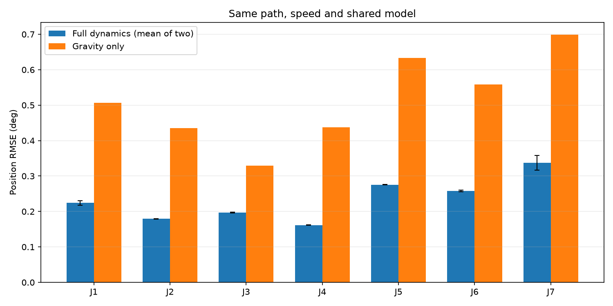
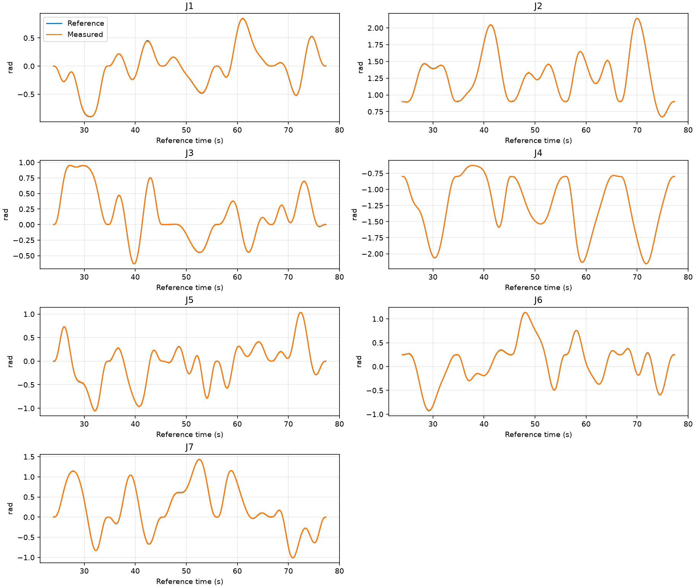
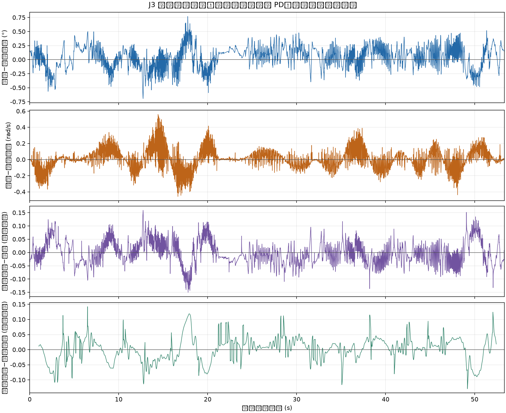

# Arm ID + Feedforward

七轴机械臂的上位机工具：离线生成激励轨迹、预览、实机采集、检查采集质量、辨识共享完整动力学参数，以及按目标轨迹发送位置、速度和力矩前馈。仓库只包含上位机代码；无需下位机源码，也不读取下位机的位置环实现。

当前版本针对随仓库提供的 EGA 七轴关节坐标与 USB 协议 v2。它不是通用机械臂驱动。默认共享参数来自一次四组采集的实机辨识；下位机控制增益仍由下位机决定。

## 安装与入口

Python 3.10+，推荐在 Linux 上使用 `uv`：

```bash
uv sync --locked --extra identify --extra preview
uv run --locked --extra identify --extra preview arm-id-host state --port /dev/ttyACM0
```

也可用 `pip install -e '.[identify,preview]'`。完整流程需要辨识和预览依赖；只运行已保存模型的前馈不需要 FIGAROH/IPOPT。

| 入口 | 功能 |
|---|---|
| `arm-id-workflow` | 第 0 步规划、预览、采集、质量分析及单组完整辨识 |
| `arm-id-collect-more` | 三组互补训练与一组验证的补充采集 |
| `arm-id-identify-many` | 从两组以上独立记录重新拟合一套共享完整模型 |
| `arm-id-feedforward` | 完整动力学或仅重力前馈，预览、确认、执行与分析 |
| `arm-id-validation-curve` | 生成新的耦合五次样条验证轨迹 |
| `arm-id-host` | 只读状态、手动控制与 USB 记录 |

示例：

```bash
uv run --locked --extra identify --extra preview arm-id-workflow --output captures/new_session
uv run --locked --extra identify --extra preview arm-id-identify-many \
  --train captures/run_1.csv --train captures/run_2.csv \
  --validation captures/held_out.csv --output results/new_fit
uv run --locked --extra preview arm-id-feedforward \
  --model results/new_fit/shared_full_model.json --speed 1.8 \
  --output captures/feedforward_new
```

`arm-id-feedforward --prepare-only` 只生成并检查执行计划，不连接实机。默认模型和 96 秒验证轨迹随包提供。实机运行需在交互界面逐步确认；轨迹位置、速度和几何约束只在生成或执行前检查，采集过程使用真实反馈位置，不会因跟踪误差或反馈越过规划余量而中断。

## 模型、示例与结果

`src/arm_id_feedforward/models/controller/robot.urdf` 保留原关节轴、坐标变换、限位和惯性字段；外观改为方块，碰撞使用简化凸包 OBJ。原始 STL 不在仓库中。凸包是离线规划代理，预览也只展示运动学；规划通过不代表真实设备无碰撞。

`data/dynamic_identification/` 包含四组动态训练记录及一组独立验证记录，可复算共享完整动力学模型。J3 训练组含一次较长反馈间断，质量报告中保留了提示。数据索引和 SHA256 在 `data/index.json`；详细说明与复算命令见 [`data/README.md`](data/README.md)。`examples/measured_excerpt.csv` 保留为快速解析示例。

## 实机效果

下图来自五段耦合验证曲线的 3 倍速实机测试。完整动力学前馈两次位置 RMSE 分别为 0.235° 和 0.246°；相同模型、轨迹和速度下，仅重力前馈为 0.527°。这是当前这台机械臂和负载下的记录。



跟踪曲线示例：





`results/` 保留历史辨识图与实机对照摘要。

辨识只用设备时间、真实反馈关节位置和反馈力矩。速度、加速度由反馈位置滤波求导；它不需要知道下位机如何跟踪位置。前馈由**目标轨迹**的 `q/dq/ddq` 与冻结共享参数计算；反馈位置只用于采集和事后分析。

## 流程与方法

目标是得到一套在上位机运行的七轴共享逆动力学模型，并用实机轨迹检查它对跟踪的作用。整体流程是“轨迹规划与预览 → 实机采集 → 数据检查 → 参数拟合 → 独立验证 → 前馈对照”。辨识直接使用采集到的反馈力矩，不要求先做静态重力标定，也不需要下位机位置环的内部信息。

### 1. 规划与采集

动态激励轨迹由五次 B 样条组成，FIGAROH/IPOPT 搜索控制点以增加各关节的动力学信息量。候选轨迹生成后，按关节位置余量、速度、加速度和简化凸包几何筛查；筛查只用于生成和执行前复核。轨迹先预览，再由操作者确认实机执行。

采集按 200 Hz 下发位置目标，同时记录设备时间戳、序号、状态位、真实反馈位置、速度和力矩。跟踪误差不会被当作采集失败；辨识使用实际反馈状态，不用命令目标代替实际运动。四组记录用于训练，另一组独立保留作验证。原始记录、轨迹和质量报告在 [`data/dynamic_identification/`](data/dynamic_identification/)；第三训练组有一次较长反馈间断，数据保留并在处理时分段。

### 2. 反馈预处理

预处理检查设备时间递增性，剔除无效状态和重复样本，并在时间戳中断处分段，不跨缺口插值。每段分别重采样；位置和反馈力矩使用 4 Hz 零相位低通滤波，速度与加速度由滤波后的**实测位置**通过三阶 Savitzky–Golay 多项式求导。每段边缘和入场过渡从拟合样本中去掉。拟合只使用各关节速度绝对值不低于 0.01 rad/s 的样本，以减少静止噪声对摩擦估计的影响。

辨识不扣除位置控制器输出，也不从反馈力矩中减掉目标力矩。拟合对象是当前关节坐标下、能预测反馈力矩的总逆动力学关系。

### 3. 共享完整动力学拟合

每个采样状态建立 `tau = Y(q,dq,ddq) theta`。回归矩阵有 91 列：70 列刚体惯性参数，之后依次是七轴粘性摩擦、库仑摩擦和转子惯量项。所有关节的数据共同拟合一组 `theta`，因此轴间耦合由整套记录共同约束，不用逐轴单独乘增益。

回归矩阵存在结构性秩亏。辨识用固定随机种子生成的参考状态池归一化列，并投影到可观测子空间，再做岭回归。多组辨识通过留出整组训练记录来选岭系数，最后用全部训练组重拟合；独立验证记录只在参数冻结后评估。冻结参数位于 [`shared_full_model.json`](src/arm_id_feedforward/models/identified/shared_full_model.json)。

91 个回归系数是力矩预测模型，不保证每个连杆的单独惯量都能被唯一、准确地恢复。结构性不可辨识和数据覆盖会让不同参数组合产生相近预测，因此模型报告同时看整组留出误差、独立验证误差和姿态覆盖；较低训练误差或满秩都不能单独证明每个物理参数准确。

### 4. 前馈和实机对照

完整前馈按**目标轨迹**计算 `tau_ff = Y(q_target,dq_target,ddq_target) theta`，200 Hz 发送位置、速度和前馈力矩。下位机继续负责坐标映射、MIT 帧编码和位置控制；模式 3 使用上位机的完整前馈，不重复叠加本地重力补偿。仅重力对照用同一模型和轨迹，将 `dq`、`ddq` 置零后计算重力项。

实机对照使用同一条五段耦合轨迹、3 倍速和同一套模型。两次完整前馈的位置 RMSE 为 0.235°、0.246°；仅重力为 0.527°。这是当前机械臂、负载和 PD 设置下的实测结果。反馈减前馈的残差还包含控制器和其他未建模误差，不能直接归因到某个单独的动力学项。

## 下位机通信接口

上位机通过 USB CDC 收发二进制帧。帧结构为 `55 53 | type:u8 | link_seq:u8 | payload_len:u8 | payload | crc16:u16-le`。CRC 初值 `0xffff`，反射多项式 `0x8408`，覆盖 `type` 至 `payload`，结果以小端发送。命令帧 `type=1`，反馈帧 `type=2`；多字节整数及 `float32` 均为小端。

命令 payload 版本为 2：

| 模式 | 长度 | payload |
|---|---:|---|
| 0 重力拖动、1 位置采集、2 只读状态 | 34 B | `version:u8, mode:u8, command_seq:u32, q[7]:float32` |
| 3 逆动力学前馈 | 90 B | `version:u8, mode:u8, command_seq:u32, q[7], dq[7], tau_ff[7]:float32` |

反馈 payload 有两种：8 B ACK 为 `version:u8, kind=1:u8, command_seq:u32, active_mode:u8, result:u8`；104 B 样本为 `version:u8, kind=2:u8, sample_seq:u32, target_seq:u32, device_time_us:u64, status:u16, q[7], dq[7], tau[7]:float32`。`status` 的 bit 0～4 依次表示反馈有效、采集模式、目标有效、命令已入队、逆动力学模式。`result=0` 表示接受；1～8 依次表示无效模式、无效位置、位置超限、电机离线、旧序号、命令过期、命令超时、无效前馈。

下位机需要实现以下行为：

1. 按上述格式解析命令，返回匹配 `command_seq` 的 ACK，持续发送带递增设备时间和样本序号的反馈。
2. 关节数组顺序固定为 J1～J7。命令位置单位 rad、速度单位 rad/s、力矩及反馈力矩单位 N·m；命令和反馈使用同一关节方向与零位。电机方向、零位、MIT 编码和 PD 增益由下位机自行处理。
3. 模式 1 接收位置目标；模式 3 接收 `q/dq/tau_ff`，把 `tau_ff` 作为上位机计算的完整前馈，不再额外叠加本地重力项。上位机默认以 200 Hz 发送，靠 ACK、`target_seq` 和 `status` 确认模式与数据对应关系。
4. 模式 2 应只读取状态，不改变当前控制模式；模式 0 可供结束或取消时回到重力拖动。通信超时及输出失能策略由下位机负责，并通过 ACK/状态反馈给上位机。

通信格式由 `src/arm_id_feedforward/arm_host.py` 实现；下位机可以使用任何内部位置跟踪算法，只要满足以上外部接口。

## 许可

代码、随仓库模型代理、示例片段、文档和图片采用 Apache-2.0；详见 [LICENSE](LICENSE) 与 [NOTICE](NOTICE)。原始 CAD STL 和下位机固件源码不包含在本仓库。
