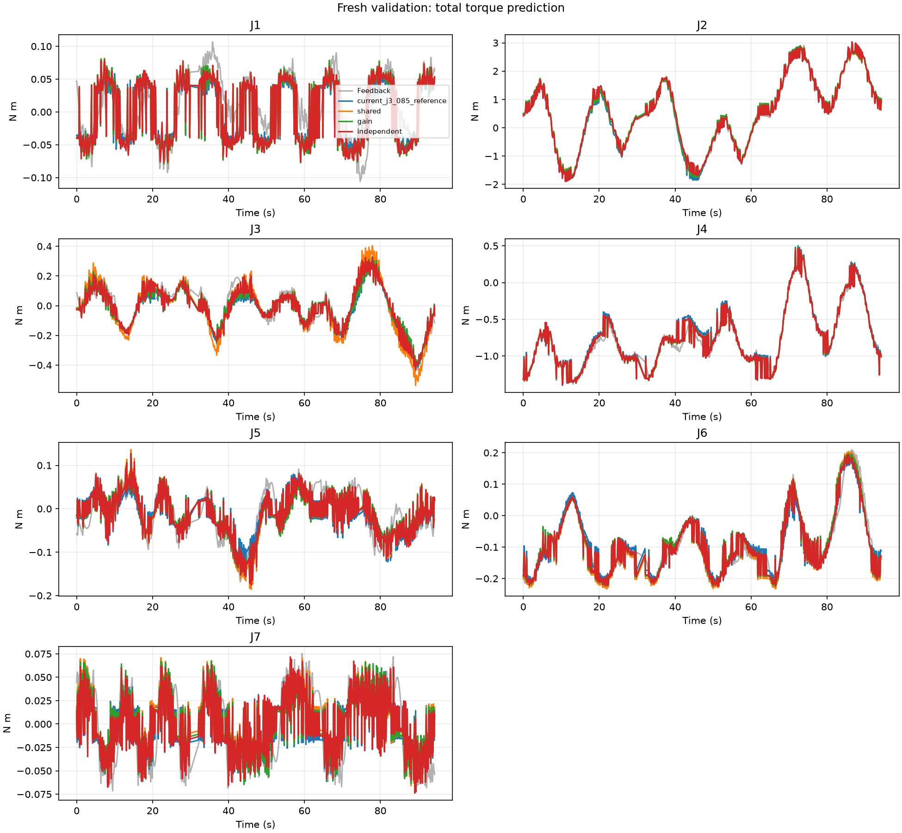
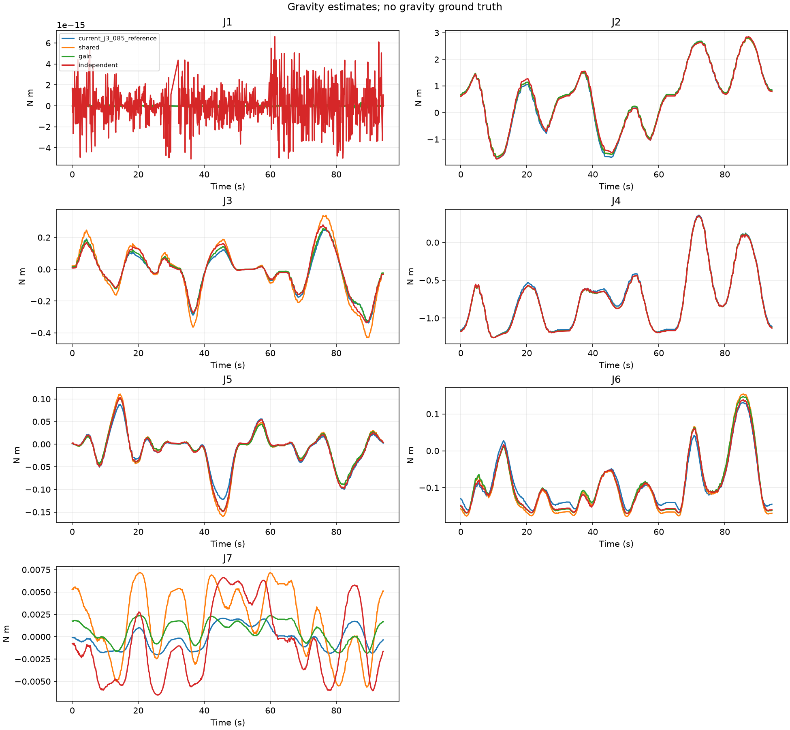

# 多组训练与新验证：上位机辨识

> 历史实验摘要。完整的四组原始记录与冻结候选 JSON 未包含在本仓库；
> `examples/measured_excerpt.csv` 仅用于展示数据格式，不足以复算本报告数值。

旧训练 72 秒 + 三组补采各 96 秒，逐文件处理后合并；新验证单独保留。
共享模型、A（独立重力倍率）、B（逐轴完整模型）均在训练数据内嵌套整组留出选择正则。
训练留出的预选模型：`independent`（按各轴运动段 RMSE 相对共享模型的均值）。
候选在读取新验证记录之前已写入 frozen_candidates.json；没有根据新验证回调参数。

## 本轮结论

补采有价值。按同一条新验证轨迹的各轴位置范围统计，超出旧训练覆盖的点占 55.9%，合并训练后降至 5.9%（剩余主要在 J3）；这不等价于七维组合覆盖或预测误差真值。

训练整组留出的预选族为 B，跨四组留出相对新共享模型的各轴误差比均值为 0.883。新验证中，B 的 J2 运动段力矩预测 RMSE 为 0.04968，当前参考为 0.11756；J4 为 0.04606，当前参考为 0.05447。J3 为 0.04052，当前人工 0.85 参考为 0.03886，尚未超过当前参考；A 的 J3 为 0.03858，与当前参考接近。

新数据上的完整预测支持逐轴模型继续作为上位机候选。当前 J3 仍保持原先已实测有效的调整；离线总力矩误差不代表松手后的纯重力效果，没有更新下位机。

## 采集质量

- `captures/01_initial/train.csv`：处理后 3503 点，检测到 0 个间断，质量提示 []。
- `captures/02_supplement_1/train.csv`：处理后 4703 点，检测到 0 个间断，质量提示 []。
- `captures/03_supplement_2/train.csv`：处理后 4593 点，检测到 1 个间断，质量提示 ['存在较长的反馈中断']。
- `captures/04_supplement_3/train.csv`：处理后 4735 点，检测到 0 个间断，质量提示 []。
- `captures/04_supplement_3/validation.csv`：处理后 4613 点，检测到 1 个间断，质量提示 []。

## 运动段力矩预测 RMSE（N·m）

| 轴 | 当前 J3×0.85 参考：新验证 | 新共享：新验证 | A：新验证 | B：新验证 | 新共享：整组留出 | A：整组留出 | B：整组留出 |
|---|---:|---:|---:|---:|---:|---:|---:|
| J1 | 0.03117 | 0.03228 | 0.03228 | 0.03193 | 0.03910 | 0.03910 | 0.03892 |
| J2 | 0.11756 | 0.09057 | 0.09033 | 0.04968 | 0.08600 | 0.08532 | 0.05669 |
| J3 | 0.03886 | 0.05309 | 0.03858 | 0.04052 | 0.07074 | 0.05022 | 0.04411 |
| J4 | 0.05447 | 0.04611 | 0.04617 | 0.04606 | 0.04362 | 0.04356 | 0.04317 |
| J5 | 0.03247 | 0.03365 | 0.03263 | 0.03221 | 0.03166 | 0.03138 | 0.03086 |
| J6 | 0.02801 | 0.02507 | 0.02514 | 0.02478 | 0.03142 | 0.03122 | 0.02994 |
| J7 | 0.03007 | 0.03034 | 0.02990 | 0.03005 | 0.02976 | 0.02946 | 0.02942 |

当前参考是原完整动力学模型的 J3 重力项乘 0.85，用于同一口径比较；实际固件只输出重力项。
已有 A/B 模型和未经 0.85 调整的原模型结果均保存在 report.json。

## 实际姿态覆盖

| 轴 | 合并训练范围 ° | 新验证范围 ° | 新验证超出旧训练范围 | 新验证超出合并训练范围 |
|---|---:|---:|---:|---:|
| J1 | -66.7～61.7 | -35.7～29.2 | 0.0% | 0.0% |
| J2 | 32.0～135.6 | 37.7～116.1 | 9.1% | 0.0% |
| J3 | -78.1～72.7 | -78.2～75.6 | 27.0% | 5.9% |
| J4 | -138.5～-38.1 | -125.0～-45.1 | 0.5% | 0.0% |
| J5 | -94.9～85.1 | -59.3～79.3 | 32.8% | 0.0% |
| J6 | -77.2～94.5 | -56.6～56.2 | 23.9% | 0.0% |
| J7 | -112.0～96.2 | -83.6～82.9 | 7.0% | 0.0% |

位置盒内不等于多轴组合覆盖充分；满秩也不保证重力分离准确。

A 最终倍率：[1.0, 1.00721, 0.75789, 0.99885, 0.92447, 0.95464, 0.32939]。没有使用人工 0.85 作为先验。

倍率以本次重新拟合的共享模型为基准，不能直接套到当前固件或与上一轮倍率作等比例换算。

## 重力项对训练组的敏感性

| 轴 | 共享重力跨组标准差 RMS | A | B |
|---|---:|---:|---:|
| J1 | 0.00000 | 0.00000 | 0.00000 |
| J2 | 0.00877 | 0.00902 | 0.00702 |
| J3 | 0.00482 | 0.00418 | 0.00549 |
| J4 | 0.00487 | 0.00458 | 0.00679 |
| J5 | 0.00457 | 0.00448 | 0.00228 |
| J6 | 0.00360 | 0.00386 | 0.00364 |
| J7 | 0.00237 | 0.00162 | 0.00153 |

在相同训练位置网格上比较各个整组留出模型；标准差不是重力真值误差。

完整预测包括惯性和摩擦项，无法单靠本表证明松手后能稳定。当前下位机参数保持不变。
新验证已用于本轮报告，后续若根据结果调算法，就不能再把它视为未见过的盲测。
